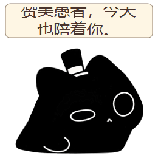

# 克喵 · Windows 桌面宠物

一只戴小礼帽的黑色猫猫虫桌宠。它会睡觉、数金币、讨饭、摸鱼、安慰你，也能通过本地 Ollama 或 OpenAI 兼容接口聊天。



[▶ 观看克喵功能演示](docs/克喵功能演示.mp4)

## 功能

- 透明置顶桌宠，可拖动、缩放和在桌面游走
- 多种睡姿、猫猫虫蠕动、摸摸、捏脸、提溜后颈等互动
- 甜冰茶、金币、要饭、偷钱与不同心情反应
- 三餐、睡觉和护眼休息提醒
- 文字与 Windows 语音输入
- 免费本地 Ollama 模型与 OpenAI 兼容 API 切换
- 可选 EPUB 本地检索，让克喵自然地回忆小说人物与经历

## 运行与编译

需要 Windows 10/11 和 .NET 10 SDK。

```powershell
dotnet restore src/KleinPet.csproj
dotnet run --project src/KleinPet.csproj
```

发布 Windows x64 便携版：

```powershell
dotnet publish src/KleinPet.csproj -c Release -r win-x64 --self-contained true -o publish
```

## AI 配置

右键托盘里的克喵，打开 AI 模型设置：

- 本地模式默认连接 `http://127.0.0.1:11434`，模型名可自行修改。
- API 模式兼容常见 Chat Completions 接口，密钥只保存在本机 `data/ai-settings.json`。
- API 密钥、聊天记录和个人配置不会写进源码仓库。

## 可选原著记忆

如果你合法持有相应 EPUB，可自行放到程序旁的 `data/books/诡秘之主.epub`。克喵会在相关聊天中检索少量片段，用来唤起和核对角色记忆。电子书不会包含在本仓库中；API 模式下，检索到的少量相关文字会发送给所选接口。

## 隐私

桌宠动画和日常互动在本地运行。只有主动发送 AI 聊天消息时，程序才会请求所选模型。本仓库不包含电子书、API 密钥、用户存档或个人聊天。

## 说明

这是个人制作的同人桌宠项目，角色及原作相关权利归各自权利人所有。仓库暂未附加开源许可证；未经许可，请不要将素材用于商业用途。

